<div align="center">

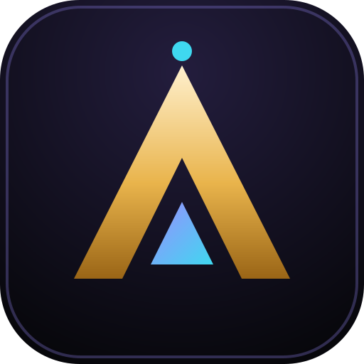

# ASCEND

**A local-first productivity RPG. Turn real goals into campaigns, quests and visible progress.**

[](https://github.com/its-harsh-here/ASCEND/actions/workflows/ci.yml)
[](https://github.com/its-harsh-here/ASCEND/actions/workflows/deploy.yml)
[](LICENSE)


### [▶ Open Ascend](https://its-harsh-here.github.io/ASCEND/)

Free · works offline · no account · your data never leaves your device

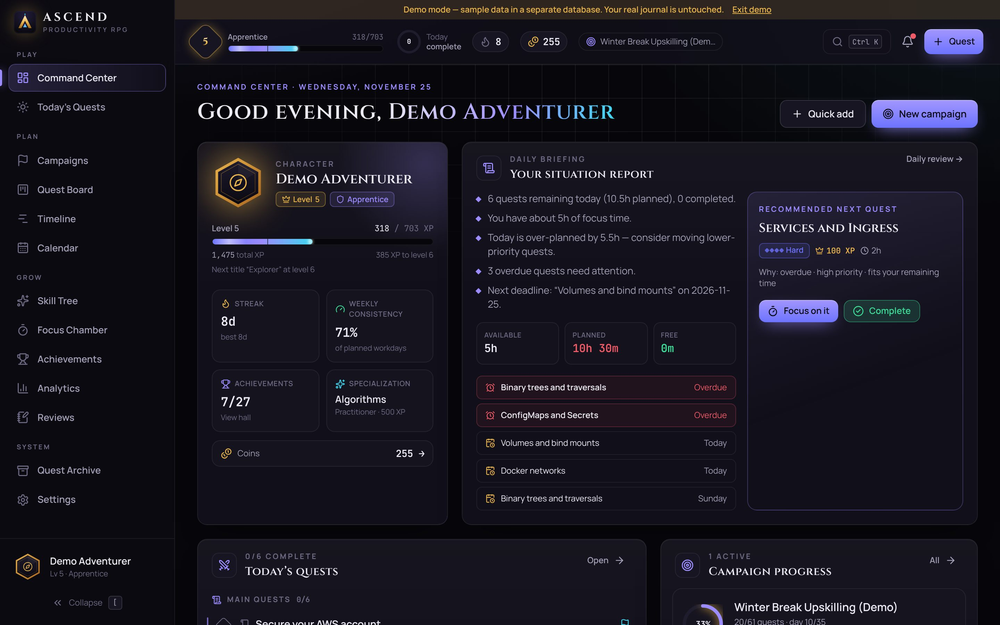

</div>

---

## What is Ascend?

Ascend is a personal productivity app that feels like a game's progression screen:

- A big goal becomes a **campaign**.
- Each area of the goal becomes a **questline**.
- Every concrete task is a **quest** with XP, a difficulty and a deliverable.
- Progress shows up as levels, a skill tree, streaks and achievements.

Some things that make it different:

- **It actually plans for you, deterministically.** Describe your goal in plain English. Ascend matches it against 21 curated learning paths (Docker, Kubernetes, AWS, DSA, ML, research, exams, fitness and more). It then builds milestones, dependencies and estimates, and schedules them around your real availability. It isn't a language model and doesn't pretend to be one. It shows you exactly which words it recognized.
- **It never overloads you silently.** If the plan doesn't fit, you see how far over it is and get fixes that have already been verified: extend the timeline, add daily time, cut optional work, or defer a goal.
- **It's yours.** No server, no sign-up, no tracking, no paid APIs. Install it as an app and it works offline.

## Screenshots

| Plan review with feasibility check | Gantt timeline with dependencies |
|---|---|
| 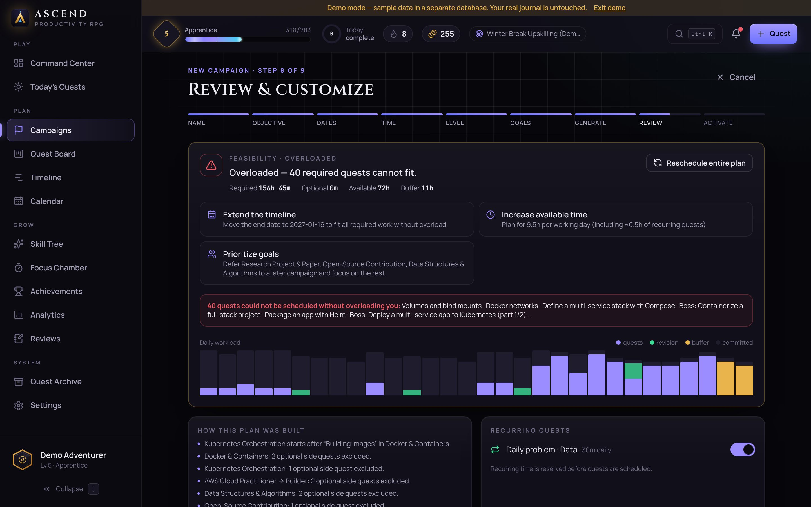 | 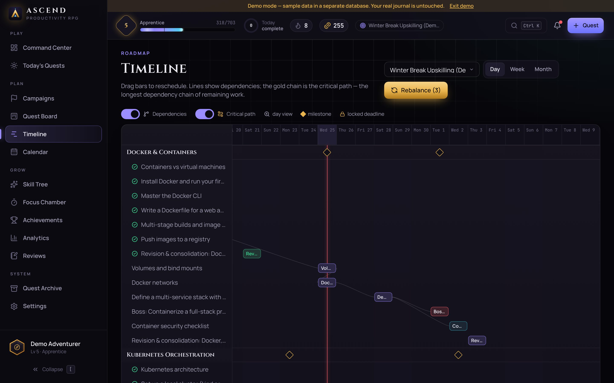 |
| **Skill tree driven by completed quests** | **Analytics from recorded data only** |
| 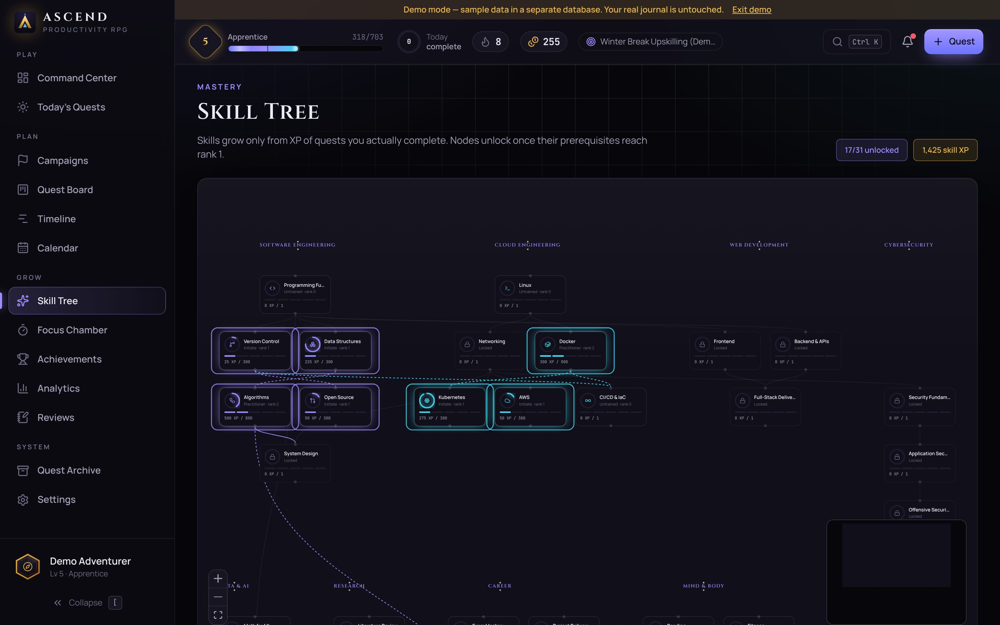 | 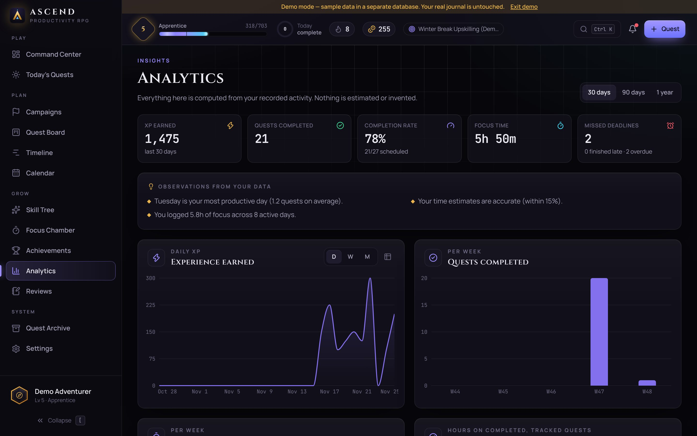 |
| **Calendar with workload and time blocks** | **Focus Chamber** |
| 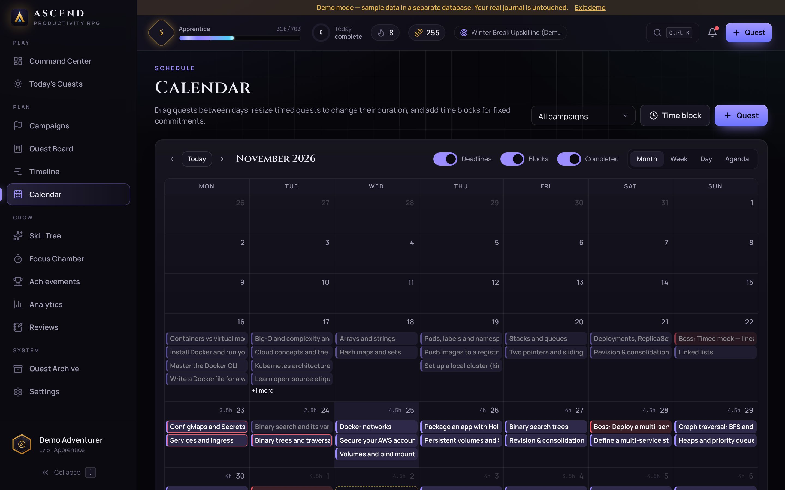 | 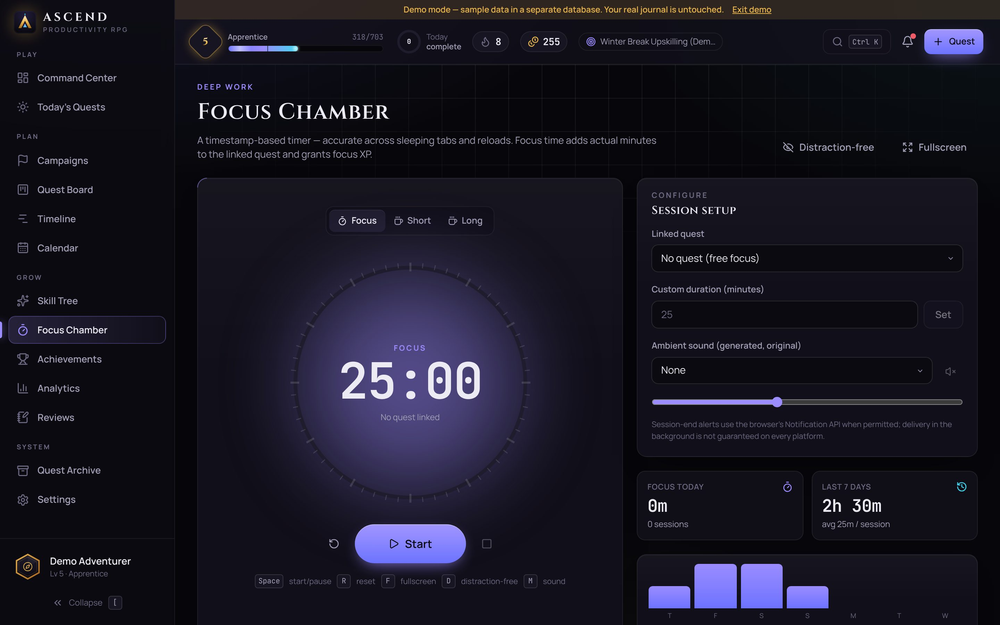 |
| **Live goal interpretation in the wizard** | **Achievements and reward shop** |
| 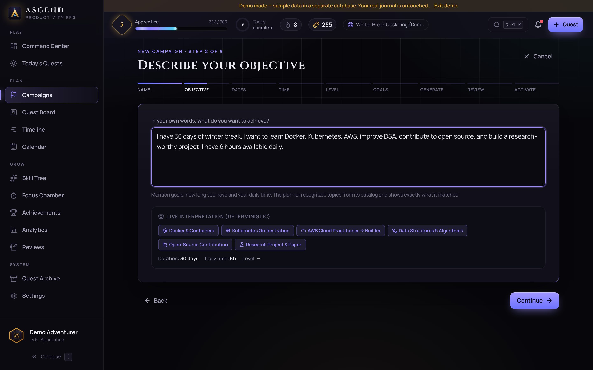 | 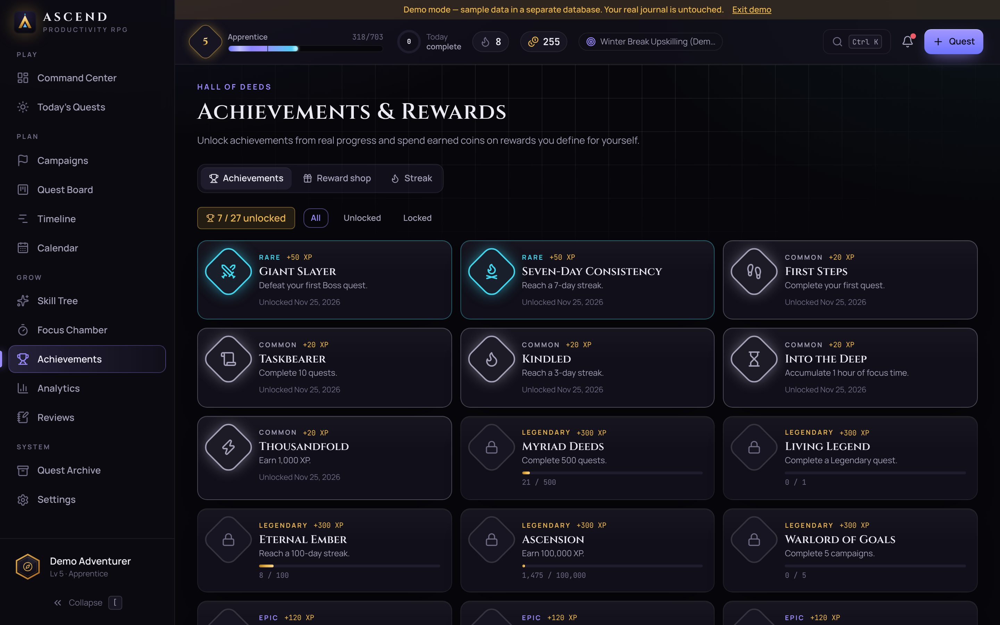 |

<p align="center">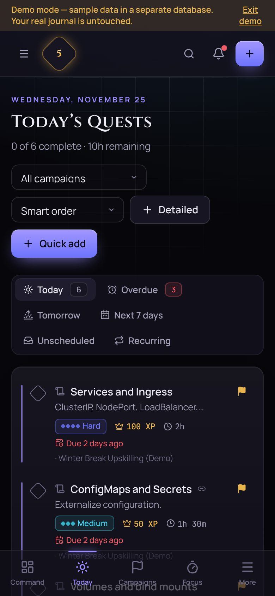</p>

## Features

<details open>
<summary><b>Planning</b></summary>

- **Campaign wizard (9 steps):** name → objective in plain language → dates → daily time and workdays → experience level and constraints → goals → generate → review → activate.
- **Planning engine:**
  - Milestones with measurable deliverables, and estimates adapted to your skill level
  - Dependency chains, including across goals (Kubernetes waits for Docker images)
  - Priorities, difficulty and XP
  - Revision and buffer days
- **Plan review:**
  - Edit, add, delete and reorder quests and milestones
  - Lock deadlines
  - Regenerate a questline without losing your edits
  - Reschedule the whole plan
- **Smart rescheduling:** missed a few days? Rebalance the remaining work from today and see a before/after preview first. Locked deadlines never move.

</details>

<details open>
<summary><b>Quests and views</b></summary>

- **Quest types:** main, side, daily, weekly, boss and legendary.
- **Quest details:** subtasks, prerequisites (with cycle detection), links, tags, notes, recurrence and XP overrides.
- **Quick add** with natural syntax: `Finish Docker networking tomorrow 2h #cloud !high`. The parsed fields are shown before saving.
- **Command palette** (`Ctrl/⌘ K`) and keyboard shortcuts.
- **Command Center:**
  - Daily briefing with a recommended next quest and why
  - Today's quests, campaign pace and a daily timeline
  - Activity heatmap
- **Quest Board:** drag-and-drop kanban, plus a list view with filters and bulk edit.
- **Timeline:** Gantt view with day/week/month zoom, drag to reschedule, dependency lines, critical path and milestones.
- **Calendar:** month, week, day and agenda views. Drag and resize, add time blocks for commitments, see the workload per day.

</details>

<details open>
<summary><b>Progression and wellbeing</b></summary>

- **XP and levels:** configurable XP and titles from Novice to Ascendant. XP is awarded at most once per quest, guaranteed at the database level.
- **27 achievements** across four rarities.
- **Skill tree** that grows only from completed work.
- **Coins and a reward shop** for real-life treats you define.
- **Streaks:** rest days never break a streak, and earned freezes protect you on a missed day.
- **Focus Chamber:** timestamp-accurate timer that survives reloads and sleeping tabs, links to quests, plays generated ambient sound, has a distraction-free mode.
- **Reviews and analytics:** daily and weekly reviews, plus analytics that only show recorded data.

</details>

## How the planner works

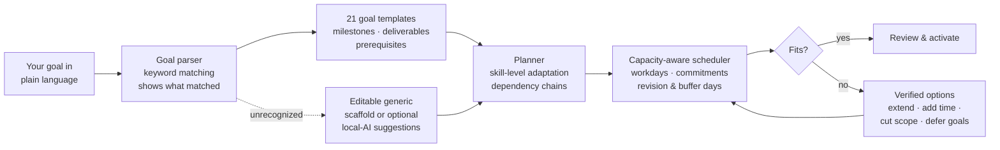

The full specification is in [`docs/ARCHITECTURE.md`](docs/ARCHITECTURE.md#5-planning-engine-specification).

## Quick start

Requires Node.js 20+ (22 recommended, see `.nvmrc`).

```bash
git clone https://github.com/its-harsh-here/ASCEND.git
```

```bash
cd ASCEND && npm install
```

```bash
npm run dev
```

Then open http://localhost:5173. Want to look around first? Pick **Explore demo mode** during onboarding. It uses a separate database, so your real data stays empty.

| Command | Purpose |
|---|---|
| `npm run dev` | Development server |
| `npm run build` | Typecheck and production build into `dist/` |
| `npm run preview` | Serve the production build on port 4173 |
| `npm run typecheck` / `npm run lint` | TypeScript (strict) / ESLint |
| `npm test` | Unit and integration tests (Vitest, fake IndexedDB) |
| `npm run e2e` | End-to-end tests (Playwright) against the production preview |

## Deployment

Ascend is a static site with hash routing, so any static host works without rewrite rules. `BASE_PATH` sets the URL prefix at build time.

**GitHub Pages (used for the live site):**

- Every push to `main` runs [`deploy.yml`](.github/workflows/deploy.yml). It typechecks, lints, runs the unit tests, builds with `BASE_PATH=/<repo>/` and publishes.
- A final **verify-live** job then opens the real URL in a browser, checks the service worker and manifest, completes onboarding and reloads offline.
- To set up a fork, go to **Settings → Pages → Source** and choose **GitHub Actions**.

**Cloudflare Pages:**

- Build command: `npm run build`
- Output directory: `dist`
- Environment variable: `NODE_VERSION=22` (leave `BASE_PATH` unset)

**Anywhere else:** run `npm run build` and serve `dist/` over HTTPS. Service workers need a secure origin.

## Your data

- Everything lives in your browser's IndexedDB **on this device only**. There is no cloud sync.
- **Browser storage is not a backup.** Clearing site data or private browsing can erase it, and so can browser storage eviction. Export regularly from **Settings → Data → Export JSON backup**. Ascend reminds you and asks the browser for persistent storage, which the browser may decline.
- Backups are versioned. On restore, every record is validated and the whole restore runs in a single transaction. CSV export is available for spreadsheets.

## Optional local AI

Ascend works fully without AI. If you want extras (milestone suggestions for unrecognized goals, description rewrites, review summaries), connect a model running on your own hardware under **Settings → Local AI**:

- **Ollama:**

  ```bash
  OLLAMA_ORIGINS="https://its-harsh-here.github.io" ollama serve
  ```

  Then pull the model:

  ```bash
  ollama pull llama3.2
  ```

  Never expose Ollama publicly.
- **WebLLM:** runs in the browser with WebGPU. The first load downloads model weights (hundreds of MB).

No API keys are used. AI is only reported as available after a real connection check. Model output is schema-validated and labelled.

## Quality

Measured, not estimated:

- **71 unit and integration tests.** They cover:
  - XP granted once (including reopen and recomplete), levels and achievements
  - Recurrence, scheduling constraints, dependency ordering and locked deadlines
  - Rescheduling, backup round-trips and validation
  - CSV injection safety, the database migration, and persistence
- **End-to-end tests:**
  - The full journey: onboarding → six-goal campaign → overload resolution → activation → quest completion → XP → skill tree → reload → backup
  - Quick add, offline mode and mobile layout
  - A live smoke test against the deployed site after every deploy
- **Lighthouse 12.6 (production build):**

  | | Performance | Accessibility | Best practices | SEO |
  |---|---|---|---|---|
  | Desktop | 100 | 100 | 100 | 100 |
  | Mobile (simulated slow 4G) | 86 | 100 | 100 | 100 |

**Stack:** React 19, TypeScript (strict), Vite 7, Tailwind CSS 4, Radix primitives, Motion, Zustand, Dexie (IndexedDB), Zod, date-fns, Recharts, dnd-kit, React Flow, FullCalendar, vite-plugin-pwa, Vitest, Playwright.

## Known limitations

- No sync between devices. Use JSON backups to move your data.
- Background notifications are not reliable on every platform, so reminders are mainly in-app.
- Goals outside the 21-template catalog get a transparent, editable scaffold rather than a tailored plan.

## Contributing

Contributions are welcome. See [CONTRIBUTING.md](CONTRIBUTING.md) and the [Code of Conduct](CODE_OF_CONDUCT.md). Report security issues privately ([SECURITY.md](SECURITY.md)). Changes are tracked in [CHANGELOG.md](CHANGELOG.md).

## License

[MIT](LICENSE).

- Fonts (Cinzel, Manrope, JetBrains Mono) are bundled via Fontsource under the SIL Open Font License.
- Icons are by [Lucide](https://lucide.dev) (ISC).
- The avatars, app icon and ambient soundscapes are original to this project.
