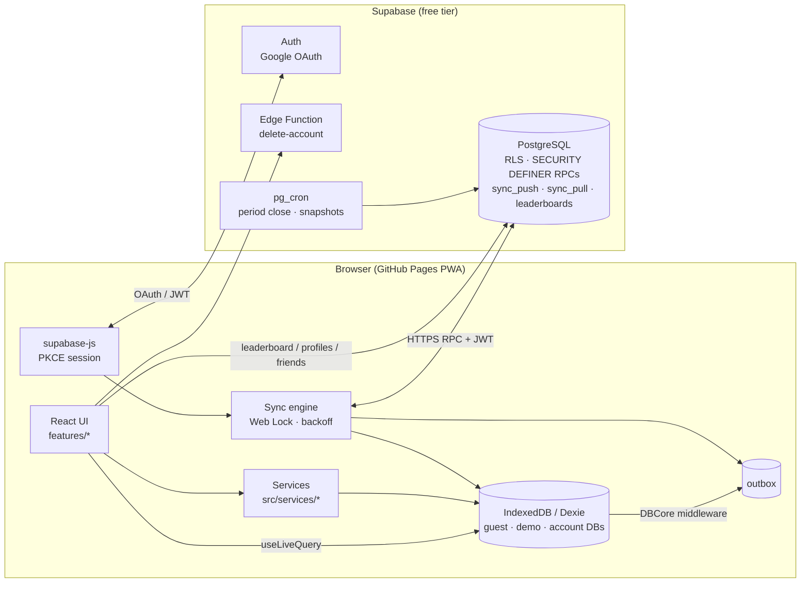
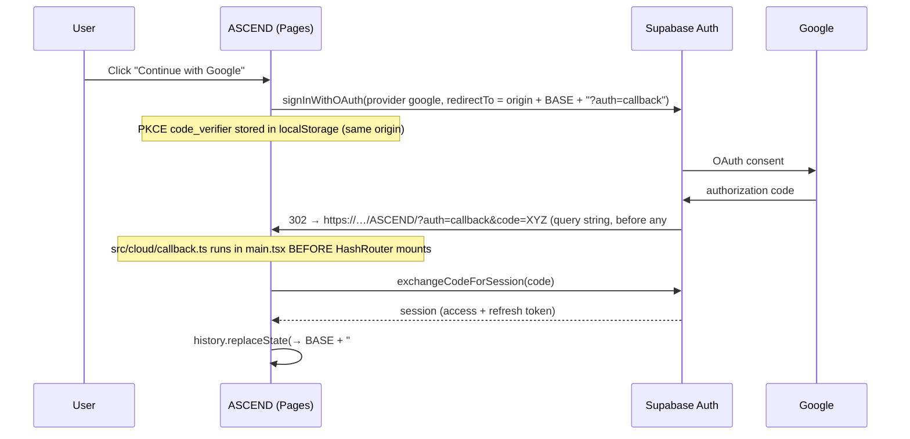
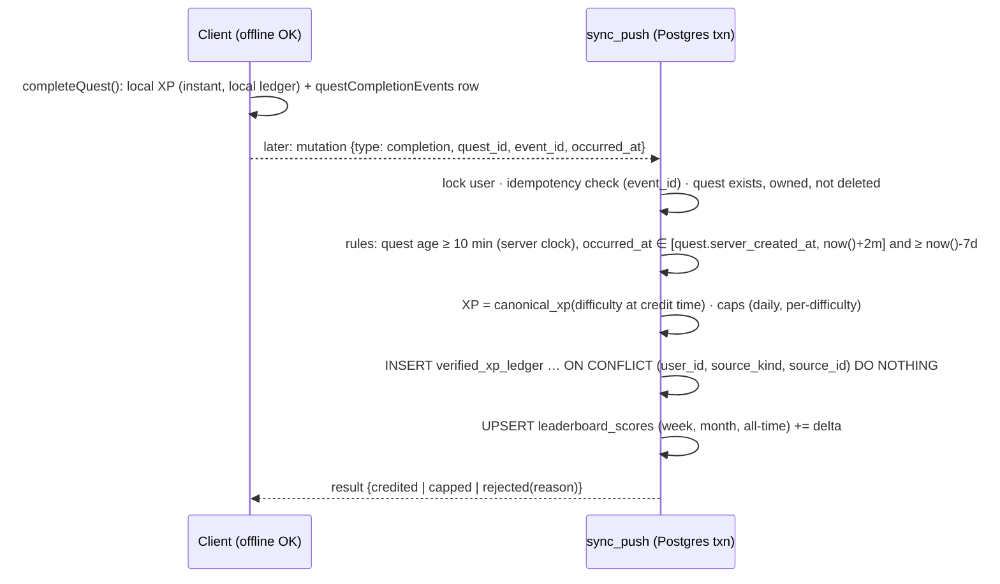

# ASCEND 2.0 — Architecture Plan

> Status: **APPROVED with decisions (2026-11-25)**: Google + guest sign-in only; GitHub Pages hosting; WebLLM kept as a self-hosted bundle; leaderboards opt-in; caps, backups and keep-alive approved. See [DECISIONS](ASCEND_2_DECISIONS.md).
> Companion documents:
> [DATABASE](ASCEND_2_DATABASE.md) · [UI/UX](ASCEND_2_UI_UX.md) · [SECURITY](ASCEND_2_SECURITY.md) ·
> [IMPLEMENTATION](ASCEND_2_IMPLEMENTATION.md) · [COST](ASCEND_2_COST_ANALYSIS.md) ·
> [DECISIONS](ASCEND_2_DECISIONS.md) · [CHECKLIST](ASCEND_2_CHECKLIST.md)

---

## 1. Executive summary

ASCEND 1.0 is a single-user, local-first PWA. All state lives in IndexedDB (Dexie). It is hosted on GitHub Pages with hash routing. 2.0 adds accounts, cloud sync, profiles, server-verified leaderboards, friends and (later) guilds. The plan keeps the parts that already work:

- **IndexedDB stays the working database.** Every screen keeps reading Dexie through `dexie-react-hooks` live queries. The cloud is a *replica* that a background sync engine reconciles. The app never waits on the network to render or to save.
- **The service layer stays the only writer.** Sync capture is added at the Dexie DBCore middleware level, so the roughly 50 existing service functions (`src/services/*.ts`) do not have to be rewritten to "also call the API".
- **Two XP ledgers, clearly separated.**
  - *Local XP* (the existing `xpEvents` table) keeps its user-configurable multipliers and works for guests and offline.
  - *Verified XP* is computed **only on the server** from synced completion events, using a fixed rule table, caps and idempotency keys. Leaderboards read verified XP only.
- **Supabase (free tier)** provides Auth (**Google OAuth only**: no passwords, no email delivery), PostgreSQL with Row Level Security, and **one** small Edge Function that needs privileged access (account deletion). There is no other backend.
- **GitHub Pages stays the host** (ADR-012). The hash router stays; the OAuth callback is handled before the router mounts.
- **Dark mode already exists.** 2.0 completes it: token gaps, the light theme, the first-paint flash and third-party widgets.

---

## 2. Audit of the existing codebase

Total source size: **~14.3k lines** of TypeScript/TSX/CSS across 93 files in `src`, `e2e` and `.github` (measured with `find … | wc -l` and `wc -l`, Nov 2026).

### 2.1 Current architecture

```
index.html ─► src/main.tsx ─► src/app/App.tsx
   Root(): useSettings() → theme sync, recurring-instance materialization, demo seeding
   ├─ Onboarding (lazy) when !settings.onboarded
   └─ AppShell: Sidebar + Topbar + MobileNav (src/app/Shell.tsx)
        HashRouter routes (lazy pages in src/features/**)
        LazyMount overlays: CommandPalette, QuickAddDialog, QuestEditorDialog
        CelebrationLayer + Toaster (src/app/Celebrations.tsx)

Data path (read):  Dexie ─► dexie-react-hooks useLiveQuery ─► src/hooks/data.ts ─► components
Data path (write): component ─► src/hooks/useQuestActions.ts / src/services/*.ts ─► Dexie transaction
Pure logic:        src/domain/* (XP, streaks, achievements, skills, recurrence, briefing, analytics, quick add)
                   src/planning/* (catalog, goalParser, planner, scheduler, feasibility, rescheduler, draftOps, critical)
Ephemeral state:   Zustand — src/store/ui.ts (dialogs, toasts, celebrations), src/store/focusTimer.ts (timer)
Optional AI:       src/ai/providers.ts (Ollama / WebLLM, validated outputs)
PWA:               vite-plugin-pwa generateSW, registerType 'prompt', navigateFallback index.html
CI/CD:             .github/workflows/ci.yml (typecheck, lint, unit, build, e2e)
                   .github/workflows/deploy.yml (build with BASE_PATH, Pages deploy, verify-live smoke test)
```

### 2.2 Module audit table

Risk: **L**ow / **M**edium / **H**igh, judged by blast radius on existing behaviour. Effort is in focused developer-days.

| Existing module | Current responsibility | Required changes for 2.0 | Risk | Effort |
|---|---|---|---|---|
| `src/db/schema.ts` (`AscendDB`, `SCHEMA_V1/V2`, `db`, `isDemoMode`, `setDemoMode`) | Versioned Dexie schema; module-level `db` instance selected by demo flag | Add **v3**: `outbox`, `syncState`, `syncConflicts` tables plus `syncRev` on synced rows. Generalize DB selection from demo/real to **guest / demo / account-scoped** (`ascend-u-<uid>`). Install the sync-capture DBCore middleware. | H | 3 |
| `src/services/quests.ts` (`completeQuest`, `reopenQuest`, `deleteQuests`, …) | Transactional quest mutations; local XP via unique `sourceKey` | Mostly **unchanged**: the middleware captures writes. `completeQuest`/`reopenQuest` additionally append a `questCompletionEvents` row (new local table) so completions sync as idempotent events, not just a status field. | M | 2 |
| `src/services/progression.ts` (`statsFrom`, `computeStats`, `evaluateAchievements`) | Derives stats and unlocks local achievements | Unchanged for local. The server ports `statsFrom` rules into SQL for *verified* achievements (subset). | L | 1 |
| `src/services/campaigns.ts` (`activatePlan`, `deleteCampaign`, `applyReschedule`, `commitmentsExcluding`) | Atomic campaign persistence and rebalancing | Unchanged: the middleware captures the bulk inserts. Deletes become tombstones upstream. | L | 0.5 |
| `src/services/backup.ts` (`exportBackup`, `validateBackup`, `restoreBackup`, `checkIntegrity`) | Versioned JSON backup, all-or-nothing restore | Restore while signed in must ask: *replace cloud too?* `restoreBackup` uses `table.clear()`, which the middleware sees as `deleteRange` → emits tombstones. Reused **as-is** for the pre-merge safety snapshot during guest→account migration. | M | 1.5 |
| `src/services/recurring.ts` (`ensureRecurringInstances`, `recurringInstanceId`) | Deterministic `rec:<rule>:<date>` instances | **Asset**: deterministic IDs make multi-device materialization idempotent (`insert … on conflict do nothing`). No change. | L | 0 |
| `src/services/core.ts` (`getSettings`, `updateSettings`, `requestPersistentStorage`) | Settings singleton | Split settings into **synced** keys and **device-local** keys (e.g. AI URL, focus volume). Mirror `theme` to `localStorage` for no-flash boot. | M | 1 |
| `src/services/demo.ts` (`seedDemoData`) | Seeds the separate demo DB | Demo stays offline-only and never syncs (middleware disabled for `ascend-demo`). | L | 0.2 |
| `src/domain/xp.ts` (`questXp`, `levelFromXp`, `xpToNextLevel`, `TITLES`) | XP curve and titles | Reused verbatim on the client; the curve is mirrored in SQL (`level_from_xp`) for public profiles. A shared test vector keeps both in lockstep. | L | 0.5 |
| `src/domain/streaks.ts` (`computeStreak`) | Compassionate streak model | Reused locally; the server computes a *verified* streak from verified completion dates in the profile timezone. | M | 1 |
| `src/domain/achievements.ts` (`ACHIEVEMENTS`, `newlyUnlocked`) | 27 achievements from `PlayerStats` | Mark each as `verifiable: boolean`. Only verifiable ones can be showcased publicly. | L | 0.5 |
| `src/domain/types.ts` (Zod schemas incl. `settingsSchema`, `questSchema`) | Validation of all records | Becomes the **sync wire contract**: every pulled row is parsed with the same schemas before it touches Dexie. Add `profileSchema`, `leaderboardRowSchema`. | M | 1 |
| `src/planning/**` | Deterministic planner and scheduler | **Untouched.** Future AI proposes `draftOps` operations validated against these functions (see §9). | L | 0 |
| `src/hooks/data.ts` (`useProfile`, `useQuestContext`, live hooks) | Live queries and derived profile | Add `useSession`, `useSyncStatus`, `useVerifiedProfile` (server, cached). Unchanged otherwise. | L | 1 |
| `src/store/ui.ts`, `src/store/focusTimer.ts` | Zustand UI state | Add `authDialog` and `syncPanel` state. Unchanged otherwise. | L | 0.3 |
| `src/app/App.tsx` (`Root`, `AppShell`, `useThemeSync`, `useGlobalShortcuts`, `PwaPrompt`) | Boot, routing, theme application | Boot order changes: handle the OAuth `?code=` **before** `HashRouter`; pick the DB by session; start the sync engine. Fix the theme flash (inline script in `index.html`). New routes. | H | 2 |
| `src/app/Shell.tsx` (`Sidebar`, `Topbar`, `MobileNav`, `Notifications`) | Navigation and top bar | New **Social** nav group, account menu, sync indicator, theme quick toggle, merged local and social notifications. | M | 2 |
| `src/app/nav.ts` (`NAV`, `NAV_GROUP_LABEL`, `G_SHORTCUTS`) | Nav model | Add a `social` group (Profile, Leaderboards, Friends). | L | 0.2 |
| `src/features/onboarding/Onboarding.tsx` | First-run flow (5 steps) | Step 0 becomes the **Gate**: *Sign in* / *Create account* / *Continue as guest*. The existing steps follow for new users. | M | 1.5 |
| `src/features/settings/SettingsPage.tsx` | All settings, Data & AI sections | New sections: **Account**, **Privacy**, **Cloud sync**; Appearance gains preview tiles. | M | 2 |
| `src/features/skills/SkillTreePage.tsx` | React Flow tree | Bug: `colorMode` ignores `system` (line 137). Use the resolved theme. | L | 0.2 |
| `src/styles/index.css`, `src/features/calendar/calendar.css` | Tokens (`:root`, `:root.light`), utilities | Add semantic tokens (sidebar, input, focus, XP, rarity, chart), audit the light palette, remove ~30 hardcoded colors (see UI/UX doc §4.3). | M | 2.5 |
| `src/ai/providers.ts` | Optional local AI | Unchanged in 2.0. Future agent tools build on `suggestMilestones`'s validate-then-preview pattern. | L | 0 |
| `index.html` | Static shell (`class="dark"`) | Inline pre-paint theme script; CSP `<meta>`. | M | 0.5 |
| `vite.config.ts` (PWA `workbox`) | Precache and SW | Exclude Supabase API from runtime caching (network-only); keep the OAuth callback URL served by `navigateFallback`. | M | 0.5 |
| `.github/workflows/ci.yml` | Typecheck, lint, unit, build, e2e | Add a **database job**: Supabase CLI local stack + pgTAP RLS tests + migration check. | M | 1 |
| `.github/workflows/deploy.yml` | Pages deploy + `verify-live` | Inject public `VITE_SUPABASE_URL` / `VITE_SUPABASE_ANON_KEY` from repository *variables* (public by design). | L | 0.3 |
| `e2e/journey.spec.ts`, `e2e/live.spec.ts` | E2E | Keep. Add auth/sync/leaderboard specs against the local Supabase stack. | M | 3 |

### 2.3 What must remain untouched

- `src/planning/**`: the deterministic planner, scheduler, feasibility and rescheduler (requirement 9).
- The local XP model and its once-only guarantee (`questSourceKey`, `&sourceKey` unique index).
- Guest/offline operation: every 1.0 journey must keep passing **with no network and no account**. The existing `e2e/journey.spec.ts` becomes the regression gate for that.
- Backup format v1. It gains optional fields only; old backups keep restoring.

---

## 3. Target architecture



### 3.1 Component responsibilities

| Component | Responsibility | Never does |
|---|---|---|
| Dexie (local) | Source of truth for the UI; works offline | Hold another user's private data |
| Sync engine (`src/sync/*`, new) | Push outbox, pull deltas, resolve conflicts, report status | Block the UI; compute verified XP |
| Postgres + RLS | Durable replica of private data; authorization boundary | Trust client XP, levels or achievements |
| `sync_push` RPC | Idempotent mutation apply; credits verified XP atomically | Accept arbitrary XP totals |
| Leaderboard RPCs | Ranked reads from precomputed period scores | Expose private fields |
| Edge Functions | Operations that need the service role | Run on every request (quota) |
| pg_cron | Close weekly/monthly periods, snapshot ranks, purge tombstones | Mutate user content |

### 3.2 New client modules

```
src/cloud/supabase.ts        createClient (PKCE, detectSessionInUrl:false), env guard → null when unconfigured
src/cloud/auth.ts            signInWithGoogle, linkGoogle, signOut, reauthenticate (fresh OAuth for deletion),
                             onAuthStateChange → session store
src/cloud/callback.ts        handleOAuthCallback(): runs before React; exchanges ?code=, cleans URL
src/cloud/profiles.ts        getMyProfile, updateProfile, checkUsername, searchProfiles
src/cloud/leaderboards.ts    getLeaderboard, getAroundMe, getFriendsBoard (typed, Zod-validated rows)
src/cloud/social.ts          friend requests, blocks, reports, notifications
src/sync/middleware.ts       Dexie DBCore middleware → outbox capture (suppressed while applying pulls)
src/sync/engine.ts           runSync(): push → pull → apply; Web Locks; backoff; status events
src/sync/conflicts.ts        per-table merge policies; three-way field merge; conflict records
src/sync/migrate.ts          guest → account migration (preview, merge, rollback snapshot)
src/features/auth/*          Gate (Continue with Google / Continue as guest), AuthCallback states
src/features/profile/*       ProfilePage, EditProfile, ShowcasePicker
src/features/leaderboard/*   LeaderboardPage, Podium, RankRow
src/features/social/*        FriendsPage, RequestsPanel, SocialNotifications
supabase/migrations/*.sql    versioned SQL (Supabase CLI)
supabase/functions/*         delete-account (Deno)
supabase/tests/*.sql         pgTAP RLS and integrity tests
```

**When cloud is not configured** (e.g. forks without Supabase env vars), `supabase.ts` exports `null`. Account UI is hidden and the app behaves exactly like 1.0. This also keeps the existing E2E suite valid.

---

## 4. Key data flows

### 4.1 Google sign-in on GitHub Pages with a hash router



- `detectSessionInUrl: false`, so supabase-js never misreads hash routes such as `#/campaigns` as implicit-grant fragments (known supabase-js behaviour; see DECISIONS ADR-004).
- The service worker's `navigateFallback` serves `index.html` for the callback URL even offline. If offline, the callback screen shows "Reconnect to finish signing in" and retries.

### 4.2 Local write → cloud

1. A service function writes inside a Dexie transaction (unchanged code).
2. The DBCore middleware appends an `outbox` row **in the same transaction**: `{mutationId (uuid), table, op, key, fields, base (pre-image of changed fields), clientTs}`. That makes the capture atomic: the data write and its sync intent commit together or not at all.
3. The UI updates immediately through the live query.
4. The sync engine (debounced 2 s, Web Lock `ascend-sync`, so one tab per browser) sends up to 200 outbox rows to `sync_push`.
5. The server applies each mutation idempotently (`sync_mutations(user_id, mutation_id)` primary key). It runs the table's merge policy and returns per-mutation results with the new `rev`/`server_seq`.
6. The client deletes acknowledged outbox rows and stores `syncRev`. Conflicts become `syncConflicts` rows surfaced in the UI.

### 4.3 Cloud → local (pull)

`sync_pull(after_seq, limit)` returns rows with `server_seq > after_seq` for `auth.uid()`, ordered, keyset-paginated. The client validates each row with the existing Zod schemas. It applies them in one Dexie transaction with the middleware suppressed (so pulled data is not echoed back), then advances `syncState.lastSeq` **in the same transaction**. A crash mid-apply therefore replays safely.

**Ordering hazard and fix.** A sequence value is assigned when the statement runs, not when it commits. So a writer could commit seq 10 *after* a reader has already pulled up to seq 11, and seq 10 would be missed for good. All writes for one user go through RPCs that first take `pg_advisory_xact_lock(hashtext(user_id))`. That serializes a user's writers, so commit order matches sequence order *within that user's partition*, which is the only partition a pull reads.

### 4.4 Quest completion → verified XP → leaderboard



Reopening a quest emits a `revoke` event. The server marks the ledger row revoked and decrements scores in the same transaction. Completing it again restores the same row and cannot double-credit.

---

## 5. Account-scoped local databases

`db` is a module-level constant today (`src/db/schema.ts:152`). It is imported directly by every service, and demo mode already swaps it by DB name plus a reload. 2.0 generalizes that proven mechanism instead of threading a DB handle through every call:

| Mode | Dexie DB name | Sync | Selected when |
|---|---|---|---|
| Guest | `ascend` (the existing name, so 1.0 users keep their data) | never | no session |
| Demo | `ascend-demo` | never | `localStorage['ascend:mode']='demo'` |
| Account | `ascend-u-<auth uid>` | yes | valid session at boot |

Signing in or out sets `localStorage['ascend:account']` and reloads, exactly like `setDemoMode`. The reload is a deliberate trade: it avoids a whole class of stale-handle bugs. Reload cost should be measured in Phase 2; nothing has been measured yet.

---

## 6. Guest → account migration

Shown once, the first time a session lands in an account DB while the guest DB has data:

| Situation | Default offer | Other options |
|---|---|---|
| Cloud empty, guest has data | **Import my guest progress** | Start fresh (guest data stays on device) |
| Cloud has data, guest empty | Use cloud data (no prompt) | — |
| Both have data | **Preview & merge** | Keep cloud only · Import guest only (replace cloud, typed confirmation) |

The merge preview groups by entity:

- campaigns with their quest counts
- standalone quests, recurring rules, rewards and reviews
- settings differences
- the local XP ledger

Records are matched by ID. IDs are UUIDs and recurring IDs are deterministic, so most records are simply unioned. Same-ID differences only occur if the guest DB was synced before, and go through the normal conflict policies.

**Rollback protection:**

1. Before anything is written, `exportBackup()` snapshots **both** datasets. They are kept as a downloadable file and copied into a local `ascend-premerge-<timestamp>` Dexie DB, retained 30 days.
2. The merge runs as a single Dexie transaction into the account DB, then syncs.
3. The guest DB is **never modified or deleted automatically**. The user can delete it later from Settings → Data.

**Verified XP is not back-credited** for imported guest history: it cannot be verified after the fact. The UI says so explicitly. See DECISIONS ADR-009.

---

## 7. Leaderboards (summary — see DATABASE §5 and SECURITY §3)

- **Default view:** Weekly XP (global) with a Friends scope toggle. Secondary tabs: Monthly and All-time. A metric switch (XP / Quests / Focus) is a Phase 5b candidate. Separate screens per metric are rejected to avoid near-identical pages.
- **Ranking:** `leaderboard_scores` is precomputed per `(period_kind, period_start, user_id)` and updated atomically with each credit. Reads use `rank() over (order by xp desc, reached_at asc)` on an index-only path. "Around me" uses a count of strictly better scores.
- **Periods:** UTC ISO weeks and UTC months, closed by pg_cron, with snapshots for rank change. Times are displayed in local time ("resets Mon 05:30 IST").
- **Eligibility:** account ≥ 24 h old, verified email or OAuth, opted in, not flagged.

---

## 8. Offline and PWA behaviour

| Capability | Offline guest | Offline signed-in | Online signed-in |
|---|---|---|---|
| Quests, campaigns, planner, focus, local XP | ✅ | ✅ (queued) | ✅ |
| Backups / CSV | ✅ | ✅ | ✅ |
| Sync | — | queued, indicator shows *Offline · N pending* | ✅ |
| Leaderboard / profiles / friends | — | last fetched snapshot (read-only, stamped "as of …") | ✅ |
| Sign in / sign up | ❌ (shows an honest message) | — | ✅ |

The service worker keeps precaching only the app shell. Supabase requests are **network-only**, never cached, so stale auth or authorization data is never served. Leaderboard snapshots for offline viewing are cached in Dexie (`cloudCache` table), not in the SW.

---

## 9. Future agentic AI and RAG — extension points (not built in 2.0)

| Extension point | Exists today | Contract for future AI |
|---|---|---|
| Plan mutations | `src/planning/draftOps.ts` (`editQuest`, `addQuest`, `removeQuest`, `moveMilestone`, `deferGoals`, …) | AI returns `AgentAction[]` = a Zod discriminated union mirroring draftOps signatures. They are applied to a **copy** of the `DraftPlan`, shown in the existing `PlanReview` diff, and committed only on user approval. |
| Goal decomposition | `genericMilestones`, `suggestMilestones` (validated JSON) | Same validate → preview → approve pipeline; the deterministic planner stays the baseline and fallback. |
| Rescheduling | `previewReschedule` → `RescheduleDialog` (already preview-then-apply) | The AI may propose *options*; the deterministic `schedule()` remains the executor. |
| Reviews | `summarizeReview` (facts-only prompt) | Weekly review narratives keep the "facts in, no invented numbers" contract. |
| RAG | — | Local-first: document chunks plus embeddings in a separate Dexie DB (`ascend-docs`) using in-browser embeddings (transformers.js / WebGPU), **or** BYO-key. Server-side pgvector is optional and opt-in only (storage budget, see COST §6). Every generated quest must cite `{docId, chunkId}`. |

AI output never bypasses validation. It enters through the same Zod schemas and service functions as human edits.

---

## 10. Requirement conflicts (surfaced, not hidden)

| # | Conflict | Resolution proposed |
|---|---|---|
| C1 | ~~₹0 vs email verification / password reset~~ | **Resolved:** Google + guest only, so no email delivery or passwords exist. ADR-006. |
| C2 | **"Never trust client XP" vs offline-first, self-reported tasks.** | Verified XP is *plausibility-bounded*, not proof. Offline completions count if synced within 7 days. Caps and anomaly flags. Documented honestly in-app. |
| C3 | **Guest mode vs leaderboards.** | Guests have local XP only. Leaderboards require an account and count only post-signup, server-received completions. |
| C4 | **GitHub Pages vs security headers.** Pages cannot set CSP, HSTS preload or `frame-ancestors` headers. | **Decided: stay on Pages** (ADR-012). `<meta>` CSP; clickjacking can't be fully prevented, but with Google-only sign-in there are no credential forms to hijack, and account deletion requires fresh re-authentication. |
| C5 | ~~Username login vs no enumeration~~ | **Resolved:** no username login (ADR-007). Usernames are for display and search only. |
| C6 | **₹0 vs reliability.** Free projects pause after 7 days of inactivity and have no automatic backups. | Weekly GitHub Actions keep-alive and nightly `pg_dump` to a private artifact (a policy gray area, flagged). Paid tier is the honest fix. |
| C7 | **₹0 vs scale.** About 500 MB database. | Comfortable for ~100 heavy users; a squeeze around ~1,000 mixed users after a year. Estimates in COST. |
| C8 | **Dark-mode "sync preference" vs "no flash".** | Boot from the `localStorage` mirror and reconcile after sync. A cross-device change may apply on the next load. |
