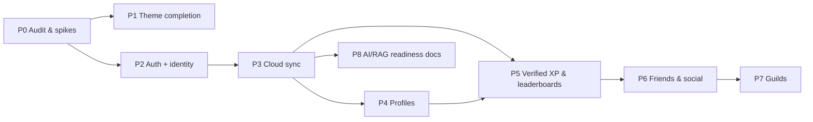

# ASCEND 2.0 — Implementation Roadmap

> Status: **APPROVED (2026-11-25)** with owner decisions: Google + guest sign-in only, GitHub Pages, WebLLM kept. Each phase ships behind its own PR(s), keeps the app working, and keeps the existing 71 unit tests + 4 E2E tests green.
> Effort is in **focused developer-days** for one experienced developer; uncertainty grows with phase number.

## 0. Ordering and dependencies

**Changes from the suggested order:**

- **P1 is independent.** It can ship first, or in parallel with P2.
- **P5 depends on P3, not only P4.** Server-side anti-cheat needs server-known quests (`server_first_seen_at`) and completion events, and those only exist once sync exists.
- **A minimal profile** (username, display name, avatar) moves **into P2**, because sign-up must claim a unique username. P4 adds the customization, privacy and showcase features.

| Phase | Effort (days) | Cumulative |
|---|---|---|
| P0 Audit & spikes | 2 | 2 |
| P1 Theme completion | 4 | 6 |
| P2 Auth + identity | 6 (was 8: no passwords/email) | 12 |
| P3 Cloud sync | 14 | 26 |
| P4 Profiles | 5 | 31 |
| P5 Verified XP & leaderboards | 8 | 39 |
| P6 Friends & social | 7 | 46 |
| P7 Guilds | 9 | 55 |
| P8 AI/RAG readiness | 2 | 57 |

---

## Phase 0 — Audit, spikes, scaffolding (2 days)

**Goals.** Retire the riskiest unknowns before writing features.

1. **Spike A — Dexie DBCore middleware.** Prove that it captures `add`/`put`/`delete`/`deleteRange`/`clear`/`bulkAdd`/`modify` inside the same transaction. Run the existing `src/services/services.test.ts` with the middleware on.
2. **Spike B — OAuth on Pages.** A throwaway Supabase project with Google. Confirm that the PKCE code lands in `location.search` with the `HashRouter` and the SW active, and that `exchangeCodeForSession` works from `main.tsx` before mount.
3. **Spike C — Local Supabase in CI.** `supabase start` on `ubuntu-latest`, timed. Run a trivial pgTAP test.
4. **Spike D — Ranking query.** Seed 100k users into local Postgres. Run `EXPLAIN ANALYZE` on keyset page and rank-around-me queries.

**Deliverables.** Spike notes appended to `ASCEND_2_DECISIONS.md` (confirming or revising ADR-003/004/011), and `supabase/` scaffolding (`config.toml`, empty migration, CI job).
**Rollback.** Spikes live on branches; nothing ships.

---

## Phase 1 — Theme system completion (4 days)

**Goals.** A complete, flash-free light/dark/system implementation with token-only colors and verified contrast.

**Modify:**

- `index.html`: inline pre-paint script (≤ 20 lines) reading `localStorage['ascend:theme']` and `ascend:accent`.
- `src/styles/index.css`: add the tokens from UI/UX §4.3; light-palette contrast fixes; `color-scheme` per theme.
- `src/features/calendar/calendar.css`: audit light mode.
- `src/app/App.tsx` (`useThemeSync`): also mirror to `localStorage`; derive `theme-color` from computed `--bg`.
- `src/services/core.ts` (`updateSettings`): mirror theme and accent to `localStorage`.
- `src/features/skills/SkillTreePage.tsx`: use the resolved theme for `colorMode` (fixes the *system* bug at line 137); token MiniMap mask.
- Replace ~41 color literals in: `src/components/ui/{primitives,button,dialog}.tsx`, `src/app/{Shell,CommandPalette,Celebrations}.tsx`, `src/components/game/widgets.tsx`, `src/features/achievements/AchievementsPage.tsx`, and the three `CAMPAIGN_HEX`/`ACCENT_HEX`/`COLOR_HEX` maps (consolidate into `src/lib/colors.ts`).
- `src/features/settings/SettingsPage.tsx`: appearance preview tiles.
- `src/app/Shell.tsx`: theme quick toggle in the account/avatar menu.

**New:**

- `src/hooks/useResolvedTheme.ts`
- `src/lib/colors.ts`
- `src/styles/contrast.test.ts` (token contrast unit test)
- `e2e/theme.spec.ts`
- `scripts/check-color-literals.mjs` (CI gate)

**Database.** None. Theme sync to the cloud arrives with P3 (`user_settings`).

**Security.** The inline script is static, so CSP needs a `sha256-` hash for it (prepares SECURITY §6).

**Testing:**

- Unit: contrast ratios ≥ 4.5 (text) and ≥ 3 (UI) for both themes.
- E2E: no-flash check. Route `page.addInitScript` captures the `<html>` class at `DOMContentLoaded` and expects it to equal the stored theme.
- E2E: system preference change via `page.emulateMedia({ colorScheme })`.
- E2E: axe on all 14 routes × 2 themes (`@axe-core/playwright` devDependency; needs approval).
- E2E: a screenshot set for visual review.

**Acceptance:**

- 0 color literals outside the allow-list.
- 0 serious/critical axe violations.
- Lighthouse a11y ≥ 98 in both themes.
- No theme flash.
- Existing tests green.

**Rollback.** Pure CSS/TS change; revert the PR. The localStorage mirror is harmless if unused.

---

## Phase 2 — Authentication and identity (6 days)

**Goals.**

- **Google sign-in** (the only account method, ADR-006/007), logout and account deletion with fresh re-authentication.
- Guest mode preserved; account-scoped local DBs.
- Minimal profile with a unique username.

**Dependencies.**

- New dependency `@supabase/supabase-js` (justified: the official client with PKCE and token refresh; ~50 KB gzip, lazy-loaded so guests never download it).
- A Supabase project, plus Google Cloud OAuth client credentials (free).

**Modify:**

- `src/main.tsx`: `await handleOAuthCallback()` before render (only if `?auth=callback`).
- `src/db/schema.ts`: DB-name resolution `guest | demo | account` (`resolveDbName()`), `setActiveAccount(uid | null)`.
- `src/app/App.tsx`: auth gate routing (`#/auth/*` outside `AppShell`), session bootstrap, sign-out handling.
- `src/features/onboarding/Onboarding.tsx`: step 0 becomes the Gate (sign in / create / guest); username claim for OAuth users.
- `src/app/Shell.tsx`: account menu; guest call to action.
- `src/features/settings/SettingsPage.tsx`: Account section (Google email read-only, username, sign out, delete).
- `vite.config.ts`: exclude `*.supabase.co` from Workbox runtime caching.
- `deploy.yml`: `VITE_SUPABASE_URL` / `VITE_SUPABASE_ANON_KEY` from repo **variables**.

**New:**

- `src/cloud/{supabase,auth,callback,profiles}.ts`
- `src/features/auth/{Gate,AuthCallback,UsernameClaim}.tsx`
- `src/hooks/useSession.ts`
- `supabase/migrations/0001_identity.sql` (profiles, user_settings stub, reserved usernames, avatar catalog, `handle_new_user` trigger creating a profile shell)
- `supabase/functions/delete-account/`
- `supabase/tests/identity.test.sql`
- `e2e/auth.spec.ts`

**Database.** `profiles` (identity columns only), `private.reserved_usernames`, `private.avatar_catalog`; RPCs `claim_username`, `check_username_available` (rate-limited), `update_profile`.

**Implementation steps:**

1. Supabase client factory returning `null` when env vars are absent. Write tests proving the app is unchanged when null.
2. `resolveDbName` plus reload-switching (unit-tested).
3. Callback handler (PKCE exchange, URL cleanup, error states).
4. Gate UI (Google + guest) and username claim with Zod validation.
5. Profile shell trigger and username claim.
6. Session lifecycle: refresh failure → banner; logout → guest DB.
7. Delete-account Edge Function (re-auth window, cascade).
8. Settings → Account.

**Security.**

- Redirect allow-list.
- No service key in the client (CI grep on `dist/`).
- Only the Google provider enabled in production; email provider disabled (documented in `docs/OPERATIONS.md`).

**Testing:**

- Vitest: schema resolution, callback parsing (code vs error), session store transitions.
- pgTAP: username constraints, reserved names, RLS on profiles.
- Playwright against local Supabase. CI cannot drive real Google consent, so the **local test stack only** enables the email provider as a *test seam*: test users are created with the admin API and signed in programmatically. The UI path under test is session restore → account DB → reload persists → logout → guest DB intact. Production config keeps the email provider disabled; a config check in CI asserts this for `supabase/config.toml` production settings.
- Google OAuth is covered by a mocked `/token` response (the real Google can't run in CI) plus a manual verification checklist.

**Acceptance:**

- All 1.0 E2E pass as a guest **with Supabase unconfigured and configured**.
- Sign-in survives reload and browser restart.
- Logout returns to an untouched guest DB.
- Account deletion removes all rows (pgTAP).

**Rollback.** Feature flag `VITE_ENABLE_ACCOUNTS=false` hides all account UI. The guest DB name is unchanged (`ascend`), so 1.0 data is never moved.

---

## Phase 3 — Cloud synchronization (14 days) ⚠ highest risk

**Goals.** Offline-first multi-device sync with idempotent mutations, tombstones, per-table conflict policies, guest migration and observability.

**Modify:**

- `src/db/schema.ts`: **v3** (`outbox`, `syncState`, `syncConflicts`, `questCompletionEvents`, `cloudCache`), with an additive upgrade test.
- `src/services/quests.ts` (`completeQuest`, `reopenQuest`): append completion events.
- `src/services/backup.ts` (`restoreBackup`): signed-in confirmation ("also replace cloud data?").
- `src/services/core.ts`: split synced vs device-local settings.
- `src/domain/types.ts`: optional `syncRev`; `questCompletionEventSchema`.
- `src/app/Shell.tsx`: sync indicator.
- `src/features/settings/SettingsPage.tsx`: Cloud sync section with the conflicts UI.

**New:**

- `src/sync/{middleware,engine,conflicts,migrate,mapping}.ts` (`mapping` = Dexie ↔ SQL field maps generated from Zod)
- `src/hooks/useSyncStatus.ts`
- `src/features/sync/{ConflictReview,MigrationWizard}.tsx`
- `supabase/migrations/0002_sync.sql`
- `supabase/tests/{sync_isolation,sync_idempotency,merge}.test.sql`
- `e2e/sync.spec.ts`

**Database.** All Phase 3 tables (DATABASE §4) with RLS, triggers, and the `sync_push`/`sync_pull`/`sync_status` RPCs.

**Implementation steps:**

1. Mapping layer and Zod round-trip tests for every table.
2. Server tables, triggers and RLS, tested with pgTAP **before** any client code.
3. `sync_push` with idempotency, advisory lock and merge policies (pgTAP per policy).
4. `sync_pull` with keyset pagination.
5. Client middleware (behind `syncEnabled` for account DBs only).
6. Engine:
   - Web Lock for one active syncer per browser
   - triggers: start, online, debounced write, 60 s visible interval
   - backoff: 1 s→2→4…→5 min with jitter
   - on 401: refresh once, then pause
7. Pull apply with suppression and checkpoint in the same Dexie transaction.
8. Conflict UI.
9. Guest → account migration wizard with pre-merge snapshot (`exportBackup` + DB copy).
10. Instrumentation: `performance.mark` around sync; Settings shows last duration and pending count.

**Failure scenarios (each gets a test):**

| Scenario | Expected behaviour |
|---|---|
| Network drops mid-push | Outbox rows remain; resend is idempotent (`sync_mutations` hit) |
| Response lost after server commit | Same as above; the client receives the stored result |
| Tab closed mid-pull apply | Dexie transaction rolls back; checkpoint not advanced; replay |
| Two tabs open | Web Lock: one syncer; the other observes via live queries |
| Device A deletes, device B edits offline | Tombstone wins; B gets a conflict offering *Restore* |
| Both devices edit quest notes | Conflict preview with both texts; no silent overwrite |
| Both devices complete the same quest | Two events, one quest; verified credit once (P5) |
| Recurring instance generated on both devices | Same deterministic ID; `on conflict do nothing` |
| Session expires while offline | Local work continues; on reconnect: refresh → sync; refresh fails → "Sign in again" banner, nothing lost |
| Client older than server schema | `upgrade_required` → PWA update prompt; outbox kept |
| Free project paused / read-only | Sync status "Cloud unavailable"; retries with long backoff; local unaffected |

**Security.** Per-user advisory lock; composite FKs; payload size limits (200 mutations / 512 KB); Zod validation on pull (a defence against a compromised server row breaking the client).

**Testing:**

- Vitest: middleware capture for every service function (parameterized), merge-policy matrix, backoff timing (fake timers), migration preview/merge/rollback.
- pgTAP: isolation for all tables; idempotency (50× same mutation); ordering under lock.
- Playwright against local Supabase:
  - **two browser contexts as two devices**: offline edit → reconnect → converge
  - delete vs edit
  - notes conflict
  - interrupted sync via `route.abort()` mid-request
  - duplicate delivery (replay recorded requests)
- **Chaos test:** 200 random operations across 2 devices with random network drops → final states identical and equal to the server (property-based, seeded).

**Acceptance:**

- The chaos test converges in 100% of 50 seeded runs.
- No duplicate rows after replay tests.
- Guest migration preview is accurate (counts match), and rollback restores the pre-merge state.
- All 1.0 tests green.
- Sync never blocks the UI: a long-task budget test checks for no main-thread task > 50 ms caused by sync, with a 2,000-quest pull.

**Rollback.**

- `VITE_ENABLE_SYNC=false` stops the engine; the outbox accumulates harmlessly.
- Server migrations are forward-only. A "pause sync" server flag in `private.config` makes `sync_push` return `paused`, so clients back off.

---

## Phase 4 — Profiles and privacy (5 days)

**Goals.** Full profile, customization, privacy controls and verified-achievement showcase.

**Modify:**

- `src/domain/achievements.ts`: a `verifiable` flag per definition.
- `src/app/nav.ts`: Social group (Profile reachable via avatar).
- `src/features/settings/SettingsPage.tsx`: Privacy section.

**New:**

- `src/features/profile/{ProfilePage,EditProfile,ShowcasePicker,ProfileCard}.tsx`
- `src/cloud/profiles.ts` (extended)
- `supabase/migrations/0003_profiles.sql`: columns from DATABASE §3.1 plus `get_profile`, `update_profile`, `change_username`, and `verified_achievements(user)` as a SQL function over the verified ledger, available once P5 lands. Until then, showcase is disabled.

**Testing.**

- pgTAP: visibility matrix (public / friends / private × viewer relation); stat nulling; username cooldown.
- Playwright: edit profile → public view as another user shows only allowed fields; private profile 404s for strangers.

**Acceptance.** The privacy matrix tests pass. No email appears in any public response (asserted by a JSON-schema check on every profile RPC).

**Rollback.** Hide routes; the columns are inert.

---

## Phase 5 — Verified XP and leaderboards (8 days)

**Goals.** A server-authoritative ledger, caps, anomaly flags, period scores, ranking RPCs and the leaderboard UI.

**Modify:**

- `supabase` `sync_push`: call `private.credit_completion` / `private.revoke_completion` within the same transaction.
- `src/features/profile/*`: show verified XP and level.
- `src/app/Shell.tsx`: Leaderboards nav.

**New:**

- `supabase/migrations/0004_leaderboards.sql` (ledger, scores, snapshots, audit, rules, cron jobs)
- `src/cloud/leaderboards.ts`
- `src/features/leaderboard/{LeaderboardPage,Podium,RankRow,HowRankingWorks}.tsx`
- `supabase/tests/{xp_rules,caps,concurrency,ranking}.test.sql`
- `e2e/leaderboard.spec.ts`

**Implementation steps:**

1. Rules table plus a shared JSON fixture, asserted by both Vitest and pgTAP.
2. Ledger and credit/revoke functions.
3. Caps and windows.
4. Score upserts.
5. Ranking RPCs (keyset, around-me, friends).
6. pg_cron: daily snapshots, period close, purge.
7. Anomaly flagging.
8. UI with podium, sticky self row, offline snapshot cache.
9. "How ranking works" content.

**Performance targets (measured on local Postgres, seeded data; recorded in the PR):**

| Query | Dataset | Target p95 |
|---|---|---|
| Leaderboard page (50 rows) | 100k users, current week | < 30 ms |
| Rank around me | 100k users | < 30 ms |
| `sync_push` with one completion credit | warm | < 50 ms server time |

**Testing.**

- pgTAP: ordering; ties (`reached_at`, then `user_id`); week/month rollover at UTC boundaries; caps; replay; reopen loop; flagged and opted-out users excluded; blocked users excluded.
- **Concurrency:** 20 parallel identical claims → exactly one credit.

**Acceptance.** All integrity tests pass; targets met; the leaderboard is fully keyboard-accessible; axe clean.

**Rollback.** Hide the leaderboard route. Ledger data is retained and inert.

---

## Phase 6 — Friends and social (7 days)

**New:**

- `supabase/migrations/0005_social.sql` (requests, friendships, blocks, notifications, reports, RPCs)
- `src/cloud/social.ts`
- `src/features/social/{FriendsPage,RequestsPanel,BlockList,ReportDialog}.tsx`
- Friends scope on the leaderboard

**Modify.** `src/app/Shell.tsx` `Notifications` merges social notifications, fetched on focus/visibility and every 2 minutes while visible. There's no realtime, to preserve quota.

**Testing.**

- pgTAP: request lifecycle, caps, block side-effects (friendship removed, invisible both ways).
- E2E: two users friend each other and see each other on the friends board; block hides them.

**Acceptance.** No social RPC exposes non-public data. Blocking is symmetric for visibility.

**Rollback.** Hide Friends; tables inert.

---

## Phase 7 — Guilds (9 days, later)

**New:**

- `supabase/migrations/0006_guilds.sql`
- `src/features/guilds/*`
- Roles and permission checks in RPCs
- Challenges and guild boards

**Anti-exploit rules:** DATABASE §7 (72 h join delay, non-transferable period contributions, 7-day cooldown, one guild per user).

**Testing.** Role permission matrix; join/leave farming scenarios.

**Rollback.** Hide the guild UI.

---

## Phase 8 — Agentic AI and RAG readiness (2 days, docs + contracts only)

- `src/ai/actions.ts` (types only): an `AgentAction` Zod union mirroring `src/planning/draftOps.ts` operations, plus a `previewActions(plan, actions)` pure function. **Unit-tested, not wired to any model.**
- A document describing:
  - the tool contracts
  - the approval UX (reusing `PlanReview`)
  - evaluation (golden-plan fixtures scored on feasibility, dependency validity and coverage)
  - local RAG storage (`ascend-docs` Dexie DB, chunking and embeddings via transformers.js, citations required)

---

## Testing and quality plan (all phases)

| Layer | Tooling | New in 2.0 |
|---|---|---|
| Unit | Vitest + fake-indexeddb (existing) | middleware, engine, merge policies, mapping, auth state, contrast |
| Component | Testing Library (installed, lightly used today) | auth forms, leaderboard rows, conflict review |
| Database | **pgTAP via `supabase test db`** | RLS isolation (all tables), constraints, idempotency, caps, ranking, definer `search_path` |
| Edge Functions | Deno test | delete-account re-auth window and cascade |
| E2E | Playwright (existing) | auth, sync (2 contexts), leaderboard, theme × axe |
| Live | `e2e/live.spec.ts` (existing, post-deploy) | add: auth page loads; anon cannot read tables (expects 401/empty) |

**CI changes (`.github/workflows/ci.yml`):**

- New job `db` runs `supabase start`, `supabase db reset`, `supabase test db`, then the e2e cloud specs. It runs only when `supabase/**` or `src/{cloud,sync}/**` change, to save minutes.
- Gates:
  - RLS-enabled check
  - color-literal check (P1)
  - `dangerouslySetInnerHTML` grep
  - service-key grep on `dist/`

### Measurable engineering metrics (honest, instrumented)

| Metric | How it is measured | Where reported |
|---|---|---|
| Sync push→ack latency p50/p95 | `performance.measure` in the engine; E2E against local stack; production telemetry opt-in only | PR descriptions, Settings → Cloud sync |
| Convergence rate | Seeded chaos test (50 runs) | CI log |
| Leaderboard query latency | `EXPLAIN ANALYZE` on seeded 100k users | PR description |
| Concurrent credit correctness | 20-parallel claim test | CI |
| Test counts / coverage | Vitest `--coverage` (`@vitest/coverage-v8` already installed) | README badge (generated, not hand-written) |
| Accessibility | axe violations per route; Lighthouse a11y | CI artifacts |
| Performance | Lighthouse mobile/desktop on the production build | README (measured values only) |

No figure is published without a reproducible command that produced it.

## Risk register

| ID | Risk | Likelihood | Impact | Mitigation |
|---|---|---|---|---|
| R-1 | Sync bugs corrupt or duplicate data | M | H | Server-first pgTAP; chaos test; pre-merge snapshots; feature flag |
| R-2 | Middleware misses a write path | M | H | Parameterized test over every service function; spike A |
| R-3 | Free tier limits hit sooner than modelled | M | M | Instrument `sync_status` storage; alerts in Settings; COST levers |
| R-4 | OAuth callback breaks after SW/router changes | L | H | Live smoke test covers `?auth=callback` handling (error path, no real Google) |
| R-5 | Users without Google accounts can't sync | M | L | Guest mode keeps every offline feature; identity linking can add providers later (ADR-006) |
| R-6 | Leaderboard perceived as unfair | M | M | Transparent rules page; caps; appeal via report |
| R-7 | Client rollback against a newer Dexie version | L | M | Never deploy a client older than the last DB version; version check at boot shows an "update" message |
| R-8 | Scope creep (guilds, chat) | H | M | Phases are independently shippable; guilds last; chat excluded |
